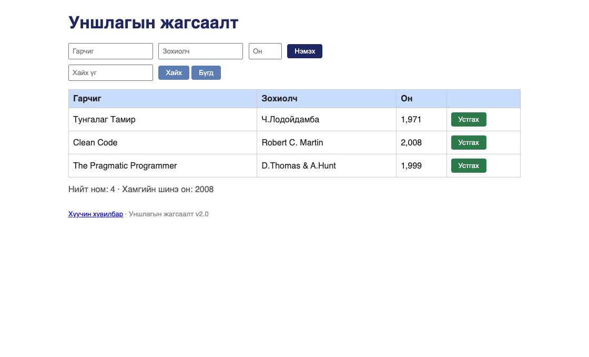

# BUG-01: Нийт номын тоолуур хүснэгтийн мөрөөс нэгээр илүү байна

**Орчин:** Уншлагын жагсаалт v2.0, Chrome 157.0.8103.79, macOS 26.3.1, Node.js v22.22.2, 2026-11-21.

**Урьдчилсан нөхцөл:** `node app.js` командаар аппыг шинээр асаасан. Анхны 3 номтой.

## Дахин гаргах алхам

1. Chrome-оор `http://localhost:3000` хаягийг нээж, анхны жагсаалт ачаалагдахыг хүлээнэ.
2. Хүснэгт дэх номын мөрүүдийг тоолж, доорх «Нийт ном» тоотой тулгана.
3. Зөрүү хоосон жагсаалтад мөн гарах эсэхийг шалгахын тулд бүх номыг «Устгах» товчоор нэг нэгээр нь устгаад тоолуурыг дахин харна.

**Хүлээгдэж байсан:** «Нийт ном» тоолуур хүснэгт дэх номын тоотой тэнцүү байна. Эхэнд 3, бүх номыг устгасны дараа 0 гэж харуулна.

**Бодит үр дүн:** Эхний 3 мөрийн доор «Нийт ном: 4» гэж харагдсан. Сүүлийн номыг устгасны дараа хүснэгт 0 мөртэй болсон ч «Нийт ном: 1» гэж үлдсэн.

**Ноцтой байдал:** Minor. Номын мөрүүд харагддаг боловч тоолуур буруу тул жагсаалт хоосон эсэхийг тоолуураар мэдэх боломжгүй.

**Хавсралт:** Анхны гурван мөр ба «Нийт ном: 4» гэсэн тоолуур.

**Олдсон аялал:** Fed-Ex. Анхны жагсаалтын зөрүүг ном устгах урсгалаар давтан шалгасан.
