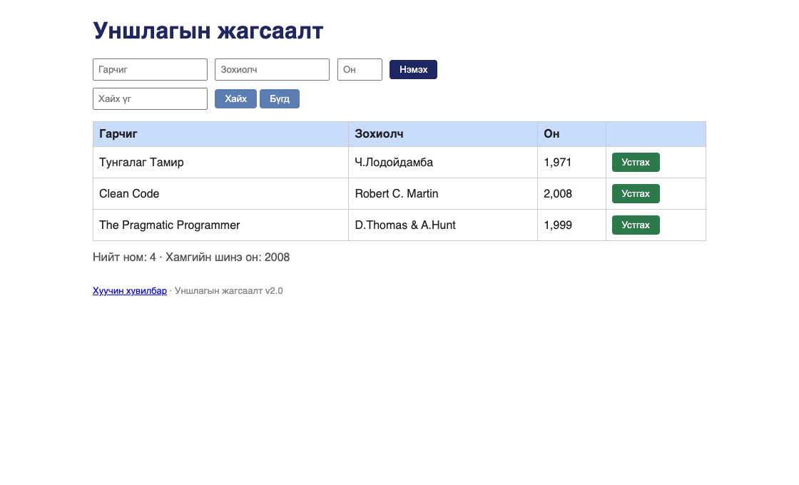

# BUG-02: Хүснэгт номын оныг мянгатын таслалтай харуулдаг

**Орчин:** Уншлагын жагсаалт v2.0, Chrome 157.0.8103.79, macOS 26.3.1, Node.js v22.22.2, 2026-11-21.

**Урьдчилсан нөхцөл:** `node app.js` командаар аппыг шинээр асаасан. Анхны 3 номтой.

## Дахин гаргах алхам

1. Chrome-оор `http://localhost:3000` хаягийг нээж, анхны жагсаалт ачаалагдахыг хүлээнэ.
2. «Он» баганад байгаа гурван номын оныг харна.

**Хүлээгдэж байсан:** «Он» багана 1971, 2008, 1999 гэсэн утгыг энгийн тоогоор харуулна.

**Бодит үр дүн:** «Он» баганад 1,971, 2,008, 1,999 гэж харагдсан.

**Ноцтой байдал:** Cosmetic. Оны утгыг унших боломжтой ч дүрслэл нь спецификацийн тоон форматтай зөрсөн.

**Хавсралт:** «Он» багана дахь таслалтай гурван утга.

**Олдсон аялал:** Supermodel.
