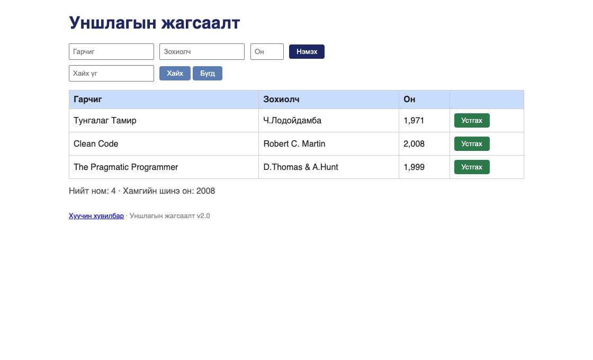

# BUG-03: Устгах товч ногоон өнгөтэй байна

**Орчин:** Уншлагын жагсаалт v2.0, Chrome 157.0.8103.79, macOS 26.3.1, Node.js v22.22.2, 2026-11-21.

**Урьдчилсан нөхцөл:** `node app.js` командаар аппыг шинээр асаасан. Анхны 3 номтой.

## Дахин гаргах алхам

1. Chrome-оор `http://localhost:3000` хаягийг нээж, анхны жагсаалт ачаалагдахыг хүлээнэ.
2. Номын мөрийн баруун талд байгаа «Устгах» товчны дэвсгэрийн өнгийг харна.

**Хүлээгдэж байсан:** Спецификацийн дагуу номыг устгах аюултай үйлдлийн товч улаан дэвсгэртэй байна.

**Бодит үр дүн:** «Устгах» товч ногоон дэвсгэртэй. Chrome-д дэвсгэрийн тооцоолсон өнгө `rgb(44, 122, 75)` байв.

**Ноцтой байдал:** Cosmetic. Устгах үйлдлийг ялгаж таниулах ёстой өнгө буруу харагдаж байна.

**Хавсралт:** Жагсаалтын ногоон «Устгах» товчнууд.

**Олдсон аялал:** Supermodel.
