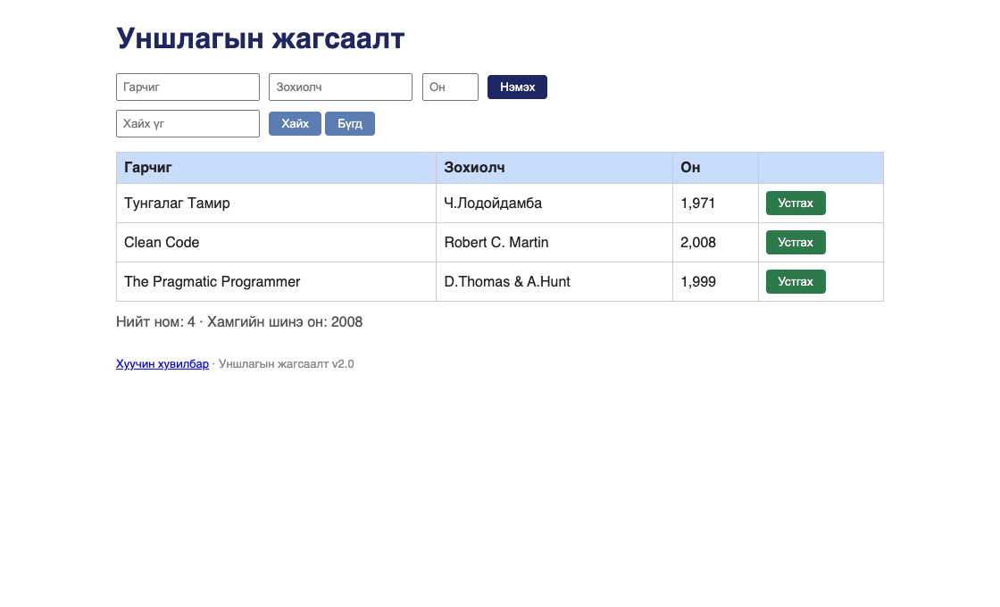

# BUG-04: Нэмэх товчны шошго латин x үсгээр төгсөж байна

**Орчин:** Уншлагын жагсаалт v2.0, Chrome 157.0.8103.79, macOS 26.3.1, Node.js v22.22.2, 2026-11-21.

**Урьдчилсан нөхцөл:** `node app.js` командаар аппыг шинээр асаасан. Анхны 3 номтой.

## Дахин гаргах алхам

1. Chrome-оор `http://localhost:3000` хаягийг нээнэ.
2. Ном нэмэх маягтын товчны шошгыг харна.
3. Латин `x` болон кирилл `х` ижил харагддаг тул Chrome-ийн JavaScript Console-ийг `Option + Command + J` товчоор нээнэ. Дүрслэгдсэн товчны сүүлийн тэмдэгтийг шалгахын тулд дараах илэрхийллийг бичиж ажиллуулна.

   ```js
   const addButton = [...document.querySelectorAll('button')]
     .find(button => button.textContent.trim().startsWith('Нэмэ'));
   'U+' + addButton.textContent.trim().at(-1).codePointAt(0)
     .toString(16).toUpperCase().padStart(4, '0');
   ```

**Хүлээгдэж байсан:** Товчны шошго кириллээр «Нэмэх» гэж бичигдэж, сүүлийн `х` үсэг `U+0445` байна.

**Бодит үр дүн:** Товчны шошго «Нэмэx» бөгөөд сүүлийн латин `x` үсгийн код `U+0078` байна.

**Ноцтой байдал:** Cosmetic. Үйлдлийн шошгонд өөр цагаан толгойн үсэг орсон бичвэрийн алдаа.

**Хавсралт:** Товчны байрлал болон шошго. Тэмдэгтийн кодыг дээрх алхмаар шалгана.



**Олдсон аялал:** Supermodel.
