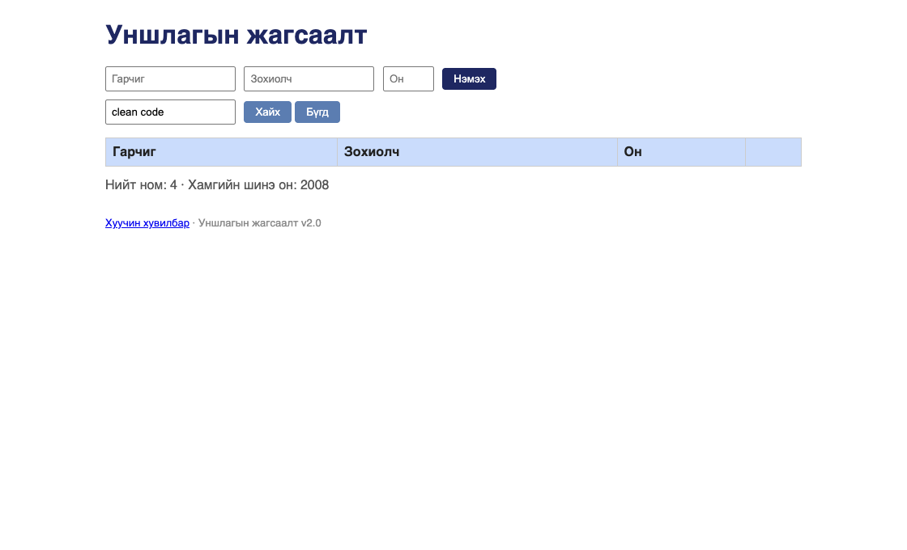

# BUG-05: Хайлтын үгийг жижиг үсгээр бичихэд тохирох ном олдохгүй

**Орчин:** Уншлагын жагсаалт v2.0, Chrome 157.0.8103.79, macOS 26.3.1, Node.js v22.22.2, 2026-11-21.

**Урьдчилсан нөхцөл:** Аппыг `node app.js` командаар шинээр асааж, `http://localhost:3000` хаягаар орно. Хүснэгтэд анхны 3 ном харагдана.

## Дахин гаргах алхам

1. «Хайх үг» талбарт `Clean Code` гэж бичээд «Хайх» товчийг дарна. «Clean Code» номын нэг мөр гарсныг харна.
2. Хайлтын талбарын утгыг `clean code` болгон солиод «Хайх» товчийг дахин дарна.
3. Хүснэгтэд гарсан номын мөрүүдийг харна.

**Хүлээгдэж байсан:** Хайлтаар гарчиг болон зохиолчийн нэрээс үсгийн том, жижиг хэлбэрийг ялгалгүй тааруулна. Аль ч хайлтаар «Clean Code» номын нэг мөр гарна.

**Бодит үр дүн:** `Clean Code` хайхад нэг мөр, `clean code` хайхад тэг мөр гарсан. Зохиолчийн нэрээр `Robert C.` болон `Ч.Лодойдамба` гэж хайхад тус бүр нэг мөр, `robert c.` болон `ч.лодойдамба` гэж хайхад тус бүр тэг мөр гарсан.

**Ноцтой байдал:** Major. Жагсаалтад байгаа номыг хэрэглэгч үсгийн том, жижиг хэлбэрийг зөрүүлж бичихэд олж чадахгүй.

**Хавсралт:**

**Олдсон аялал:** Fed-Ex.
