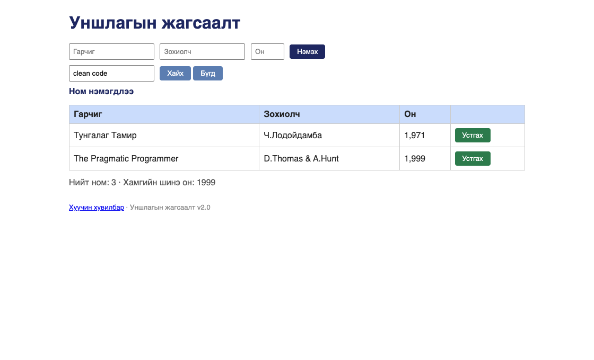

# BUG-06: Ном устгасны дараа «Ном нэмэгдлээ» гэж мэдэгддэг

**Орчин:** Уншлагын жагсаалт v2.0, Chrome 157.0.8103.79, macOS 26.3.1, Node.js v22.22.2, 2026-11-21.

**Урьдчилсан нөхцөл:** Аппыг `node app.js` командаар шинээр асааж, `http://localhost:3000` хаягаар орно. Хүснэгтэд анхны 3 ном харагдана.

## Дахин гаргах алхам

1. «Clean Code» номын мөр дэх «Устгах» товчийг дарна.
2. Хүснэгтээс энэ мөр алга болж, 2 мөр үлдсэнийг харна.
3. Хүснэгтийн дээрх мэдэгдлийг уншина.

**Хүлээгдэж байсан:** Үйлдлийн мэдэгдэл ном амжилттай устсаныг илэрхийлнэ. Жишээ нь «Ном устгагдлаа» гэж харагдана.

**Бодит үр дүн:** «Clean Code» мөр алга болж, хүснэгтэд 2 ном үлдсэн. Мэдэгдэл «Ном нэмэгдлээ» гэж гарсан.

**Ноцтой байдал:** Minor. Устгах үйлдэл амжилттай дууссан ч мэдэгдэл буруу мэдээлэл өгдөг.

**Хавсралт:**

[Шинээр асаасан апп дээрх давтан шалгалтын зураг](../screenshots/bug-06-fresh.png)

**Олдсон аялал:** Fed-Ex.
