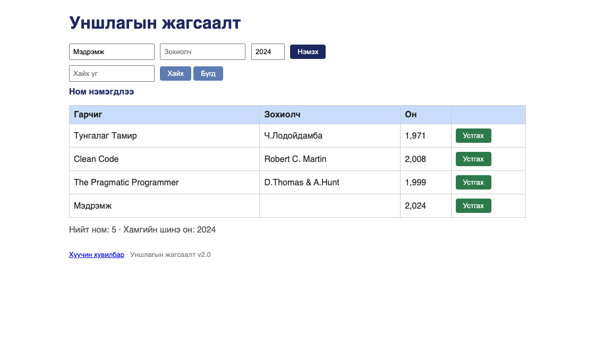

# BUG-07: Заавал бөглөх талбар хоосон байхад ном нэмэгддэг

**Орчин:** Уншлагын жагсаалт v2.0, Chrome 157.0.8103.79, macOS 26.3.1, Node.js v22.22.2, 2026-11-21.

**Урьдчилсан нөхцөл:** Аппыг `node app.js` командаар шинээр асааж, `http://localhost:3000` хаягаар орно. Хүснэгтэд анхны 3 ном харагдана.

## Дахин гаргах алхам

1. «Гарчиг» талбарт `Мэдрэмж`, «Он» талбарт `2024` гэж бичнэ. «Зохиолч» талбарыг хоосон үлдээнэ.
2. Ном нэмэх товчийг дарна.
3. Үйлдлийн мэдэгдэл болон хүснэгтийн сүүлийн мөрийг харна.

**Хүлээгдэж байсан:** Гарчиг, зохиолч, он заавал бөглөгдөнө. Зохиолч хоосон тул ном нэмэгдэхгүй, хүснэгт 3 мөртэй хэвээр үлдэж, зохиолчийн нэрийг оруулахыг сануулсан алдааны мэдэгдэл гарна.

**Бодит үр дүн:** Хүснэгтийн 4 дэх мөрөнд «Мэдрэмж» ном нэмэгдсэн ч зохиолчийн нүд хоосон байна. Мэдэгдэл «Ном нэмэгдлээ» гэж гарсан. Туршилт бүрийн өмнө аппыг шинээр асааж шалгахад гарчиг дангаар хоосон, он дангаар хоосон, гурван талбар бүгд хоосон үед мөн шинэ мөр үүссэн.

**Ноцтой байдал:** Major. Номын үндсэн мэдээлэл дутуу байхад хадгалж, хэрэглэгчид амжилттай болсон гэж мэдэгддэг.

**Хавсралт:**

**Олдсон аялал:** Couch Potato.
