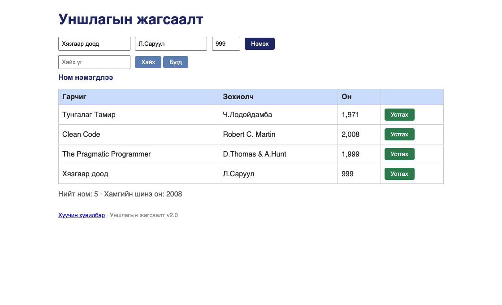

# BUG-08: Хязгаараас гадуур эсвэл бүхэл тоо биш онтой ном нэмэгддэг

**Орчин:** Уншлагын жагсаалт v2.0, Chrome 157.0.8103.79, macOS 26.3.1, Node.js v22.22.2, 2026-11-21.

**Урьдчилсан нөхцөл:** Аппыг `node app.js` командаар шинээр асааж, `http://localhost:3000` хаягаар орно. Хүснэгтэд анхны 3 ном харагдана.

## Дахин гаргах алхам

1. «Гарчиг» талбарт `Хязгаар доод`, «Зохиолч» талбарт `Л.Саруул`, «Он» талбарт `999` гэж бичнэ.
2. Ном нэмэх товчийг дарна.
3. Үйлдлийн мэдэгдэл болон хүснэгтийн сүүлийн мөрийн оныг харна.

**Хүлээгдэж байсан:** Он нь 1000-аас 2100 хүртэлх бүхэл тоо байна. `999` утгатай номыг нэмэхгүй бөгөөд хэрэглэгчид оны зөвшөөрсөн хязгаарыг тайлбарласан алдааны мэдэгдэл харуулна.

**Бодит үр дүн:** «Ном нэмэгдлээ» гэж мэдэгдэж, 4 дэх мөрөнд `999` онтой ном нэмэгдсэн. `2101`, `1999.5`, `abcd` утгыг шалгахад мөн шинэ мөр нэмэгдэж, «Он» баганад харгалзан `2,101`, `1,999.5`, `NaN` гарсан. Зөвшөөрсөн хязгаарын `1000` ба `2100` утга амжилттай нэмэгдсэн.

**Ноцтой байдал:** Major. Жагсаалтад зөвшөөрсөн хязгаараас гадуурх тоо, бутархай тоо, тоо биш утга хадгалагддаг.

**Хавсралт:**

**Олдсон аялал:** Couch Potato.
