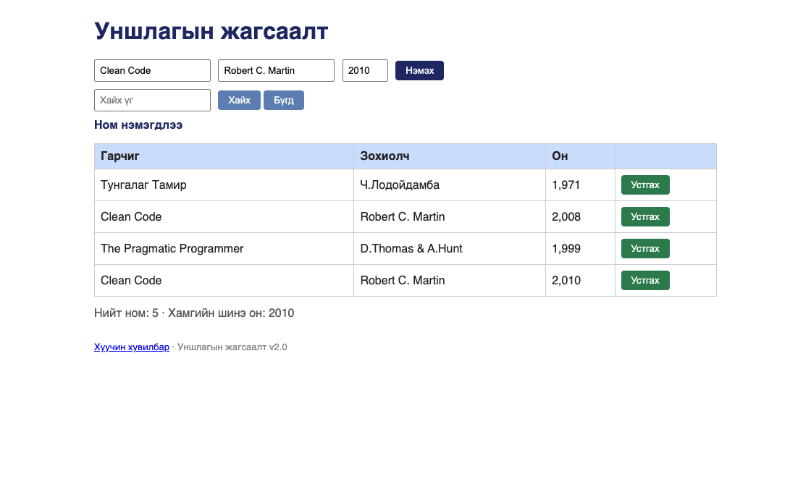

# BUG-09: Ижил гарчиг, зохиолчтой номыг давхардуулж бүртгэдэг

**Орчин:** Уншлагын жагсаалт v2.0, Chrome 157.0.8103.79, macOS 26.3.1, Node.js v22.22.2, 2026-11-21.

**Урьдчилсан нөхцөл:** Аппыг `node app.js` командаар шинээр асааж, `http://localhost:3000` хаягаар орно. Анхны 3 ном дунд `Clean Code` · `Robert C. Martin` · `2008` бүртгэл байна.

## Дахин гаргах алхам

1. «Гарчиг» талбарт `Clean Code`, «Зохиолч» талбарт `Robert C. Martin`, «Он» талбарт `2010` гэж бичнэ.
2. Ном нэмэх товчийг дарна.
3. Хүснэгтэд `Clean Code` гарчигтай, `Robert C. Martin` зохиолчтой хэдэн мөр байгааг шалгана.

**Хүлээгдэж байсан:** Ижил гарчиг, зохиолчтой номыг давхардуулж нэмэхгүй. Хүснэгтэд өмнөх `Clean Code` номын нэг мөр хэвээр үлдэнэ.

**Бодит үр дүн:** «Ном нэмэгдлээ» гэж мэдэгдэж, анхны `2008` оны номын хажууд ижил гарчиг, зохиолчтой `2010` оны ном нэмэгдсэн. Нийт 4 мөр болсон. Аппыг шинээр асааж `2008` онтойгоор давтан туршихад он хүртэл адил хоёр мөр үүссэн.

**Ноцтой байдал:** Major. Нэг номыг олон удаа бүртгэснээр жагсаалтын бүртгэл давхарддаг.

**Хавсралт:**

**Олдсон аялал:** Fed-Ex.
