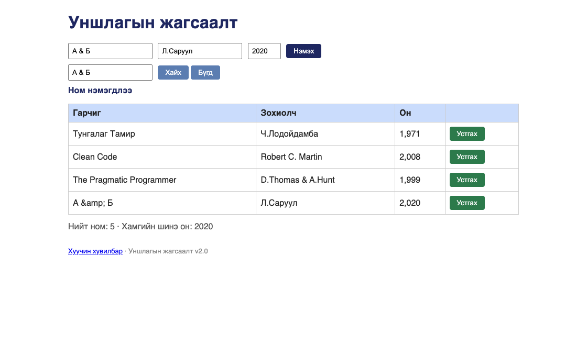
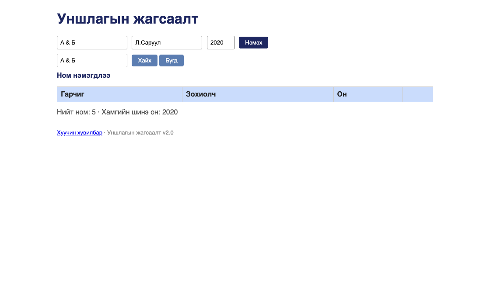

# BUG-10: Номын гарчиг дахь `&` тэмдэгт өөрчлөгдөж, оруулсан гарчгаар хайхад ном олдохгүй байна

**Орчин:** Уншлагын жагсаалт v2.0 · Chrome 157.0.8103.79 · macOS 26.3.1 · Node.js v22.22.2 · 2026-11-21

**Урьдчилсан нөхцөл:** `node app.js` командаар аппыг шинээр асаана. Chrome-оор `http://localhost:3000` хаягийг нээхэд анхны гурван ном харагдана.

## Дахин гаргах алхам

1. Гарчигт `А & Б` (кирилл үсгээр), зохиолчид `Л.Саруул`, онд `2020` гэж оруулаад «Нэмэx» товчийг дарна.
2. Хүснэгтийн шинэ мөрийн гарчгийг харна.
3. «Хайх үг» талбарт `А & Б` гэж оруулаад «Хайх» товчийг дарна.
4. Хайлтын утгыг `А &amp; Б` болгож, «Хайх» товчийг дахин дарна.

**Хүлээгдэж байсан:** Гарчиг оруулсан `А & Б` хэлбэрээрээ харагдаж, энэ гарчгаар хайхад нэмсэн ном олдоно.

**Бодит үр дүн:** Гарчиг `А &amp; Б` болж харагдсан. Анх оруулсан `А & Б` утгаар хайхад 0 мөр, дэлгэцэд гарсан `А &amp; Б` утгаар хайхад 1 мөр гарсан. Зохиолчид `A & B Press` (латин үсгээр) оруулахад зохиолчийн нэрэнд ижил өөрчлөлт гарсан.

**Ноцтой байдал:** Minor. `&` агуулсан нэр өөрчлөгдөж, тухайн номыг анхны бүтэн гарчиг эсвэл зохиолчийн нэрээр хайхад олдохгүй.

**Хавсралт:** Хүснэгтэд харагдсан гарчиг болон анхны гарчгаар хайсан үр дүн.

**Олдсон аялал:** Fed-Ex
