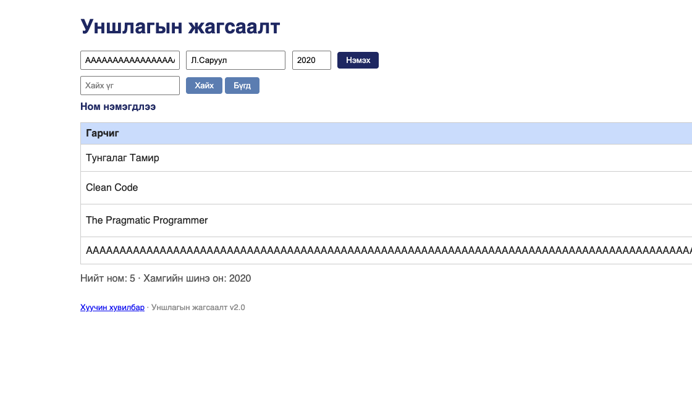

# BUG-11: Зайгүй урт гарчиг хүснэгтийн баруун багануудыг дэлгэцээс гаргаж байна

**Орчин:** Уншлагын жагсаалт v2.0 · Chrome 157.0.8103.79 · macOS 26.3.1 · Node.js v22.22.2 · 2026-11-21

**Урьдчилсан нөхцөл:** `node app.js` командаар аппыг шинээр асаана. Chrome-оор `http://localhost:3000` хаягийг нээхэд анхны гурван ном харагдана. Браузерын хуудасны харагдах хэсгийг 1120 × 680 пиксел, томруулалтыг 100% болгоно.

## Дахин гаргах алхам

1. Доорх 120 ширхэг кирилл `А` үсгийг хуулж, «Гарчиг» талбарт оруулна.

   ```text
   АААААААААААААААААААААААААААААААААААААААААААААААААААААААААААААААААААААААААААААААААААААААААААААААААААААААААААААААААААААААА
   ```

2. Зохиолчид `Л.Саруул`, онд `2020` гэж оруулаад «Нэмэx» товчийг дарна.
3. Хөндлөн гүйлгэхээс өмнө хүснэгтийн зохиолч, он, устгах товчны баганууд харагдаж байгаа эсэхийг шалгана.

**Хүлээгдэж байсан:** Урт гарчиг оруулсан ч хүснэгтийн бүтэц хадгалагдаж, бусад багана болон устгах товч харагдах хэсэгт багтана.

**Бодит үр дүн:** Хүснэгт 860-аас ойролцоогоор 1588 пиксел болж өргөссөн. Хуудасны нийт өргөн 1120-оос 1718 пиксел болсон. Зохиолч, он, устгах товчны багануудыг харахын тулд хөндлөн гүйлгэх шаардлагатай болсон.

**Ноцтой байдал:** Minor. Ном нэмэгдсэн боловч урт гарчигтай үед мөрийн мэдээлэл, устгах товчийг харахад нэмэлт үйлдэл шаардана.

**Хавсралт:** Урт гарчиг нэмсний дараах хүснэгт.



**Олдсон аялал:** Supermodel
