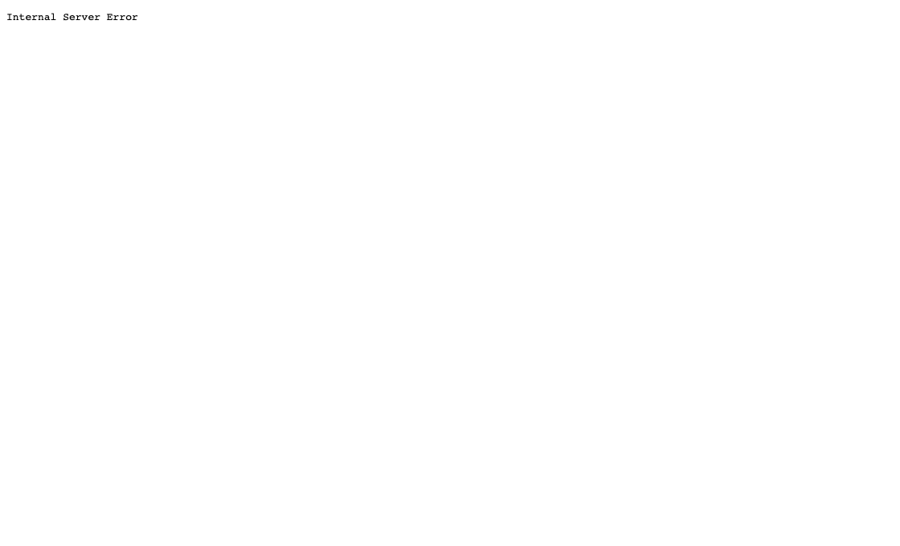

# BUG-12: Хуучин хувилбар холбоосыг дарахад HTTP 500 алдаа гарч байна

**Орчин:** Уншлагын жагсаалт v2.0 · Chrome 157.0.8103.79 · macOS 26.3.1 · Node.js v22.22.2 · 2026-11-21

**Урьдчилсан нөхцөл:** `node app.js` командаар аппыг шинээр асаана. Chrome-оор `http://localhost:3000` хаягийг нээхэд анхны гурван ном харагдана.

## Дахин гаргах алхам

1. Нүүр хуудасны доод хэсэгт байрлах «Хуучин хувилбар» холбоосыг дарна.
2. Нээгдсэн хуудасны хаяг болон дэлгэцэд харагдах хариуг шалгана.
3. HTTP статусыг баталгаажуулахын тулд тусдаа терминалд `curl -i http://localhost:3000/old` командыг ажиллуулна.

**Хүлээгдэж байсан:** Холбоос ажиллаж, хуучин хувилбарын хуудас нээгдэнэ.

**Бодит үр дүн:** Браузер `/old` хаяг руу шилжээд `Internal Server Error` гэж харуулсан. `curl -i`-ийн хариу `HTTP/1.1 500 Internal Server Error` байсан.

**Ноцтой байдал:** Minor. Аппын үндсэн жагсаалт ажиллаж байгаа ч холбоосоор хуучин хувилбарт нэвтрэх боломжгүй.

**Хавсралт:** Браузерт харагдсан алдаа болон [curl-ийн бүтэн HTTP хариу](../evidence/bug-12-curl.txt).

**Олдсон аялал:** Supermodel
